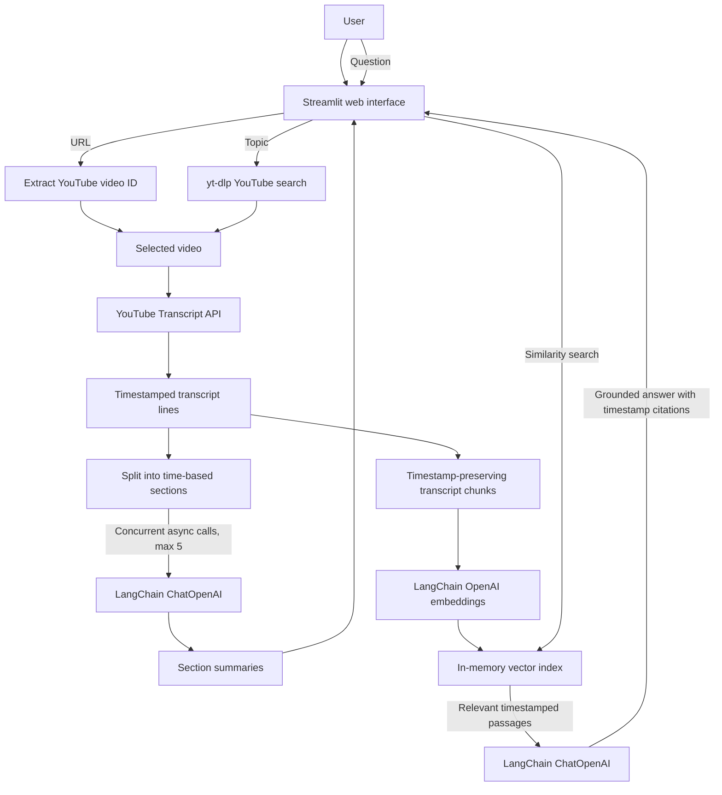

# YouTube Research Assistant

A Streamlit app that searches YouTube by topic or accepts a video URL, fetches its
English transcript, summarizes transcript sections concurrently, and answers
questions using a timestamp-preserving LangChain vector index.

## Architecture



### Request flow

1. The interface accepts a YouTube URL or searches YouTube for a topic; yt-dlp
   supplies search results without requiring a YouTube Data API key.
2. The YouTube Transcript API fetches English transcript lines with their original
   start times and durations.
3. The transcript is split into two parallel paths: time-based sections are
   summarized concurrently, and text chunks with start/end metadata are embedded
   into a LangChain in-memory vector store.
4. For each question, the vector store retrieves the five closest transcript
   passages. LangChain sends those passages to the chat model, which answers with
   clickable citations linked to the passages' YouTube timestamps.

The vector index and question history are session-local; nothing is persisted
between app sessions.

## Requirements

- Python 3.10+
- An OpenAI API key (used for chat completions and embeddings)
- Network access to YouTube and the OpenAI API

## Run locally

```bash
python -m venv .venv
source .venv/bin/activate
pip install -r requirements.txt
cp .env.example .env
```

Add your OpenAI API key to `.env`, then:

```bash
streamlit run app.py
```

Python HTTPS requests use the operating system's trusted certificate store. If
your network uses a private certificate authority, install and trust that CA in
the operating system certificate store before running the app.

The key is read from the environment and should never be committed. Search uses
yt-dlp's YouTube search; no YouTube Data API key is required. Only videos with an
available English transcript can be analyzed. Transcript passages and the in-memory
vector index live only in the running Streamlit session.

Section summaries are requested concurrently with a limit of five in-flight model
calls. Q&A retrieves the five most relevant transcript passages and returns
clickable YouTube citations at the passage start times.

## Tests

Run the URL parsing, timestamp/indexing, concurrent-summary, and Q&A citation tests:

```bash
python -m unittest -v test_youtube_research
```
